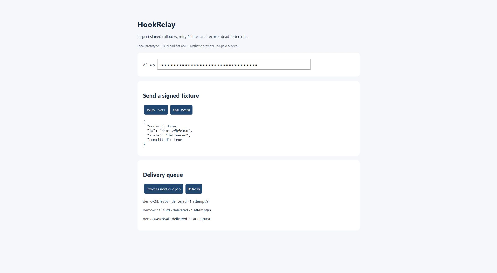
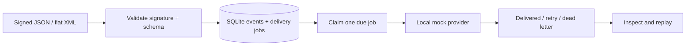

# HookRelay

[](https://github.com/apoorvkumarvcd23-coder/hookrelay/actions/workflows/tests.yml)

A local integration workbench for service-status callbacks: validate a signed
JSON/XML event, queue it durably, inspect failed delivery and replay dead-letter
jobs. It makes authentication, schema and timeout problems visible without a
real messaging account or paid provider.

**TypeScript · Node.js 24 · built-in HTTP/SQLite · no npm dependencies**



## Run the demo

Node.js 24+ is required for native TypeScript stripping and `node:sqlite`.
SQLite may emit an experimental-feature warning on this runtime.

```sh
npm run keys
npm run mock
```

In a second terminal, from the same directory:

```sh
npm start
```

Open **http://127.0.0.1:8100**. Copy `HOOKRELAY_API_KEY` from the ignored `.env`
into the key field. Send a JSON or XML fixture, then click **Process next due
job** and **Refresh**. The job becomes `delivered` when the local mock accepts it.
Keys remain in page memory and are never included in this repository.

To demonstrate retries, stop/restart the mock with two simulated failures:

```powershell
# PowerShell
$env:MOCK_FAILURES = '2'
npm run mock
```

```sh
# macOS/Linux equivalent
MOCK_FAILURES=2 npm run mock
```

Send a fresh event. Process it, wait for its backoff, and process it again. The
first two requests fail with 503; the third succeeds. Retry scheduling is durable
but dispatch is deliberately manual in this small workbench, not a background
service. No endpoint sends SMS, places calls or contacts real customers.

## Event path



The event contract is `eventId`, `ticketId` and status
`open | in_progress | resolved`. Flat XML uses these three elements inside
`<event>`; attributes, entities, DTDs and nesting are explicitly unsupported.
This is a project-specific signing protocol, **not** a Plivo V3 implementation.

## Reliability and security choices

- HMAC-SHA256 authenticates the timestamp and exact request body; five-minute
  timestamp tolerance and timing-safe digest comparison.
- Unique event IDs deduplicate delivery retries. Conflicting content with an
  existing ID returns 409; the original event is never overwritten.
- Event and delivery-job inserts share a transaction.
- Jobs have durable attempts, exponential backoff, bounded `Retry-After`, a
  four-attempt limit and dead-letter replay.
- Worker leases permit recovery after interruption. Stale workers cannot
  overwrite a newer owner's result.
- The outbound event ID remains the idempotency key. The mock receiver deduplicates
  it. This demonstrates at-least-once delivery with receiver cooperation, not
  end-to-end exactly-once guarantees for arbitrary providers.
- Network calls have a timeout; redirects are refused. Error bodies and secrets
  are not saved in diagnostics. The API key protects jobs, dispatch and replay.
- Servers bind only to loopback. Target configuration is local operator input,
  not an arbitrary callback URL accepted from incoming events.

## Verify

```sh
npm test
```

Nine tests exercise tampering/stale signatures, JSON/XML normalization,
duplicate conflicts, delayed retries, permanent failures, rate limiting,
dead-letter replay, crashed/stale workers, network errors and durable reopen.
GitHub Actions runs the same suite. Mock behavior is test data, not provider SLA
evidence. SQLite databases, `.env` and generated credentials are excluded.

## Prototype boundary

This small implementation uses SQLite instead of the future PostgreSQL design.
It has a single local workspace, shared operator key and manual dispatch. There
is no real provider integration, multi-tenant access model, full XML parser,
automatic worker service or hosted deployment. Before external use, add proper
identity, key rotation, TLS, quotas, retention, migrations and destination policy.
All examples use synthetic service events; no employer code or private data.
